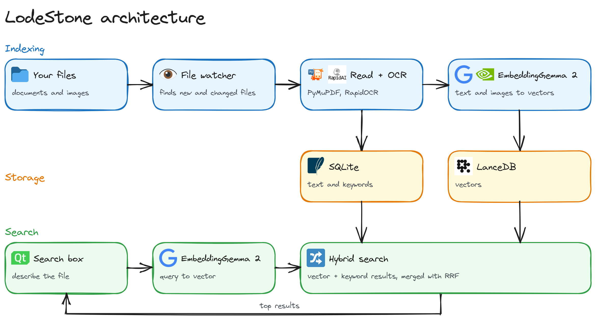

# LodeStone

Local semantic search for files and images on Windows.

## Run

Double-click `LodeStone.bat`. The first run downloads the models (about 1.5 GB), then indexes
Desktop, Documents, Downloads and Pictures. Change folders under **Settings**.

Closing the window keeps it indexing in the system tray. Use **Quit** in the tray menu to stop it.

It runs on the CPU by default. **Settings > Use GPU if available** indexes images about 30x faster
but uses up to about 4 GB of VRAM. Models unload when idle: indexing after 1 minute, search after 10.

The index is in `%LOCALAPPDATA%\LodeStone` and holds copies of your documents' text.

## Setup

```
uv venv --python 3.12 .venv
uv pip install --python .venv\Scripts\python.exe torch torchvision --index-url https://download.pytorch.org/whl/cu130
uv pip install --python .venv\Scripts\python.exe -e ".[dev]"
.venv\Scripts\python.exe -m pytest
```

## How it works



| Part | Method |
|---|---|
| Embeddings | EmbeddingGemma 2 (text and images in one vector space) |
| OCR | RapidOCR with PP-OCRv6, on the CPU |
| Vectors | LanceDB, exact search under 10,000 vectors, then `IVF_HNSW_SQ` |
| Files, text, keywords | SQLite with FTS5 |
| File changes | `watchdog`, plus a rescan at startup and every 6 hours |
| UI | PySide6 |


## Limits

- Only about the first 500 tokens of each file are embedded (`embed_token_limit` in `config.py`).
- OCR on a scanned PDF stops at the same limit, so later scanned pages aren't searchable.
- Images under 200x200 px on both sides, or blank, very blurry or unreadable, are found by filename
  only. **Settings > Name-only images** can override this.
- `.doc`, `.ppt`, `.xls`, `.rtf` and `.heic` are found by filename only. Code files aren't indexed.
